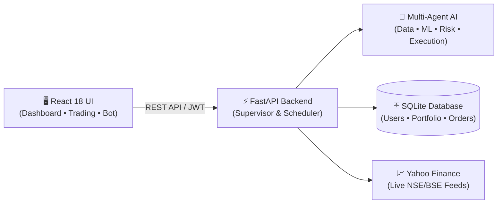

# 🤖 StockAI - Intelligent Stock Prediction & Multi-Agent Trading Assistant

<div align="center">


**An intelligent stock analysis, machine learning prediction, and paper trading system powered by multi-agent AI architecture.**

[Features](#-features) • [Architecture](#-architecture) • [Project Structure](#-project-structure) • [Setup](#-setup) • [API Endpoints](#-api-endpoints) • [Limitations](#️-limitations)

</div>

---

## 📖 Overview

**StockAI** is a full-stack financial technology web application designed to analyze Indian stocks (NSE), generate short-term price predictions using Machine Learning, and simulate paper trading in a risk-free environment with **₹10,00,000 in virtual cash**.

> ⚠️ **Disclaimer:** This is an educational and research project. All trading is **simulated** (paper trading) — no real money or broker accounts are involved. Predictions are statistical estimates, not financial advice.

---

## ✨ Features

### 📊 Stock Analysis
- **120+ Indian Stocks (NSE)** across Banking, IT, Auto, Pharma, FMCG, and Energy sectors.
- **Real-Time Market Prices** via Yahoo Finance with live `.NS` ticker updates.
- **Market Indices Tracking** — NIFTY 50, SENSEX, BANK NIFTY, NIFTY IT, etc.
- **Historical Charts** with customizable timeframes (1W to 1Y+).
- **Interactive Dashboards** with animated market movers (top gainers and losers).

### 🤖 AI & Machine Learning
- **Ensemble ML Models** combining Linear Regression and Random Forest.
- **Technical Indicators Suite** — RSI, MACD, SMA, EMA, Bollinger Bands, and ATR.
- **BUY / SELL / HOLD Signals** with probability-based confidence scores.
- **Multi-Level Risk Assessment** (Low / Medium / High) with explainable reasoning.

### 👥 Multi-Agent Architecture
- **Supervisor Agent**: Central orchestrator dispatching tasks across the agent pipeline.
- **Market Data Agent**: Ingests, normalizes, and cleans live market OHLCV data.
- **Technical Analysis Agent**: Computes momentum, volatility, and trend indicators.
- **Prediction Agent**: Manages model inference and price direction forecasts.
- **Risk Management Agent**: Validates stop-loss, position sizing, and maximum exposure.
- **Portfolio Agent**: Tracks live cash balance, open positions, and realized/unrealized P&L.
- **Auto-Trading Agent**: Executes autonomous simulated trades based on consensus signals.

### 💼 Paper Trading Engine
- **₹10,00,000 Virtual Capital** allocated per user account.
- **Simulated Execution Engine** with realistic slippage, brokerage, and transaction costs.
- **Dynamic Portfolio Tracker** with interactive asset allocation charts.
- **Complete Audit Trail** of all buy/sell transactions and orders.
- **Personalized Watchlist** for tracking prospective trades.

### 🤖 Autonomous Trading Agent
- **Market Hours Enforcement**: Restricts active trading to 9:15 AM – 3:30 PM IST.
- **Configurable Risk Parameters**: Max position limits, daily loss thresholds, and min confidence filters.
- **Emergency Kill Switch**: Immediate shutdown and position freeze capability.
- **Automated Scheduler**: Background cycles managed via APScheduler.

### 💬 Multilingual AI Chatbot
- **Trilingual Support**: English, Hindi (हिंदी), and Marathi (मराठी).
- **Automatic Language Detection**: Responds in the user's selected or typed language.
- **Context-Aware Analytics**: Answers questions on individual stocks, indicators, and user holdings.

### 🎨 Modern UI & Security
- **Modern Glassmorphic Design** with responsive dark/light mode toggle.
- **Smooth Transitions** powered by Framer Motion.
- **JWT Authentication** with Bcrypt password encryption and protected routes.
- **SQL Injection Defense** using SQLAlchemy ORM data binding.

---

## 🏗️ Architecture

### High-Level System Flow (Horizontal)



### Multi-Agent Decision Pipeline

```text
[1. Market Data] ──▶ [2. Indicators] ──▶ [3. ML Forecast] ──▶ [4. Trend & Volatility]
                            │
[8. Paper Execution] ◀── [7. Decision Engine] ◀── [6. Risk Gate] ◀── [5. Portfolio Check]
```

---

## 📁 Project Structure

```text
stock-ai-trading-system/
├── backend/
│   ├── app/
│   │   ├── agents/          # Multi-agent trading orchestration & APScheduler
│   │   ├── api/ & routers/  # FastAPI REST endpoints (auth, stocks, trading, chat, bot)
│   │   ├── models/          # SQLAlchemy ORM models (user, stock, portfolio, orders)
│   │   ├── ml/ & indicators/# ML ensemble models & technical indicator calculations
│   │   ├── providers/       # Market data providers (Yahoo Finance & mock fallback)
│   │   ├── database.py      # Database engine & session management (SQLite / SQL Server)
│   │   └── main.py          # FastAPI application entrypoint & startup lifecycle
│   ├── scripts/             # Data seeding (120+ NSE stocks, indices, migrations)
│   └── requirements.txt     # Python backend dependencies
│
├── frontend/
│   ├── src/
│   │   ├── components/      # UI components (Header, MarketMovers, StockCard, Chatbot)
│   │   ├── pages/           # Pages (Dashboard, StockDetail, Portfolio, AutoTrading)
│   │   ├── context/         # Auth & Theme Context providers
│   │   └── services/        # Axios API client
│   ├── package.json         # Frontend dependencies (React 18, Vite, Chart.js)
│   └── vite.config.js       # Vite build configuration
│
├── run_all.bat              # One-click Windows launcher (starts backend + frontend)
├── run_backend.bat          # Standalone backend launcher
├── run_frontend.bat         # Standalone frontend launcher
└── README.md                # Project documentation
```

---

## 🛠️ Technology Stack

### Backend & AI
| Technology | Role |
| :--- | :--- |
| **Python 3.11+** | Core programming language |
| **FastAPI** | High-performance asynchronous REST API framework |
| **SQLAlchemy** | SQL ORM and data modeling |
| **SQLite / PostgreSQL** | Database storage (zero-config SQLite default) |
| **scikit-learn** | Machine Learning algorithms (Random Forest, Linear Regression) |
| **pandas & numpy** | Financial time-series processing and feature engineering |
| **yfinance** | Real-time and historical market data acquisition |
| **APScheduler** | Background automated trading and task scheduling |
| **JWT & Passlib** | Secure user authentication and password hashing |

### Frontend
| Technology | Role |
| :--- | :--- |
| **React 18** | Component-based frontend architecture |
| **Vite** | High-speed frontend build and development tool |
| **React Router** | Client-side page navigation |
| **Framer Motion** | UI animations and transition effects |
| **Chart.js & Recharts** | Interactive candlestick, line, and allocation charts |
| **Axios** | HTTP communication with backend REST API |

---

## 🚀 Setup & Installation

### Prerequisites
- **Python 3.11+**
- **Node.js 18+**

### 1️⃣ Quick Start (Windows)
Double-click or run the root script:
```powershell
.\run_all.bat
```
*This automatically starts both the FastAPI Backend and the React Frontend in separate windows.*

---

### 2️⃣ Manual Setup

#### Backend Setup
```powershell
cd backend

# Create and activate virtual environment
python -m venv .venv
.venv\Scripts\activate

# Install dependencies
pip install -r requirements.txt

# Start backend server (auto-seeds stocks on first startup)
python -m uvicorn app.main:app --port 8000 --host 0.0.0.0
```
- **Backend API**: `http://localhost:8000`
- **Interactive Swagger Docs**: `http://localhost:8000/docs`

#### Frontend Setup
```powershell
# In a new terminal window
cd frontend

# Install dependencies and start Vite dev server
npm install
npm run dev
```
- **Frontend Web Application**: `http://localhost:5173`

---

## 🔌 API Endpoints

| Category | Method | Endpoint | Description |
| :--- | :--- | :--- | :--- |
| **Authentication** | `POST` | `/api/auth/register` | Register a new user account |
| **Authentication** | `POST` | `/api/auth/login` | Login and obtain JWT token |
| **Authentication** | `GET` | `/api/auth/me` | Fetch current authenticated user |
| **Stocks** | `GET` | `/api/stocks/` | List all tracked stocks with sectors |
| **Stocks** | `GET` | `/api/stocks/{symbol}` | Get real-time stock price and details |
| **Stocks** | `GET` | `/api/stocks/{symbol}/history` | Historical OHLCV candle data |
| **Stocks** | `GET` | `/api/stocks/analyze/{symbol}` | Complete AI indicators & ML forecast |
| **Stocks** | `GET` | `/api/stocks/market/indices` | Benchmark indices (NIFTY, SENSEX) |
| **Stocks** | `GET` | `/api/stocks/market/movers` | Top market gainers and losers |
| **Trading** | `POST` | `/api/trading/buy` | Execute paper BUY order |
| **Trading** | `POST` | `/api/trading/sell` | Execute paper SELL order |
| **Portfolio** | `GET` | `/api/portfolio/` | Portfolio balance, holdings, and P&L |
| **Portfolio** | `GET` | `/api/portfolio/transactions` | Full trade execution history |
| **Watchlist** | `GET` | `/api/watchlist/` | Retrieve user watchlist |
| **Watchlist** | `POST` | `/api/watchlist/` | Add stock to watchlist |
| **Watchlist** | `DELETE`| `/api/watchlist/{id}` | Remove stock from watchlist |
| **Auto-Trading** | `GET` | `/api/auto-trading/status` | Current status of auto-trading bot |
| **Auto-Trading** | `POST` | `/api/auto-trading/start` | Start autonomous trading agent |
| **Auto-Trading** | `POST` | `/api/auto-trading/stop` | Stop autonomous trading agent |
| **Auto-Trading** | `POST` | `/api/auto-trading/emergency-stop` | Emergency kill switch |
| **Auto-Trading** | `GET` | `/api/auto-trading/logs` | Auto-trading activity and trade logs |
| **Chatbot** | `POST` | `/api/chat/` | Send query to multilingual assistant |
| **Chatbot** | `GET` | `/api/chat/sessions` | Fetch user chat history |

---

## 🧪 Testing

```powershell
# Run backend tests
cd backend
pytest

# Run frontend tests
cd frontend
npm test
```

---

## ⚠️ Limitations

- **Paper Trading Only**: Designed strictly for simulation and learning; no real broker APIs or funds are connected.
- **Statistical Estimates**: Predictions are algorithmic estimates based on historical patterns, not guaranteed forecasts.
- **Market Hours**: Autonomous trading operations only execute during NSE market hours (9:15 AM – 3:30 PM IST).
- **Asset Scope**: Built exclusively for Indian equity stocks; derivatives (F&O) and commodities are not covered.
- **Data Limits**: Leverages public Yahoo Finance feeds, which may experience occasional rate throttling.

---

## 🔮 Future Enhancements

- [ ] Sentiment Analysis on real-time financial news feeds.
- [ ] Backtesting Engine with custom strategy parameters.
- [ ] Direct Broker Integration (Zerodha Kite, Upstox API).
- [ ] Deep Learning Models (LSTM, Temporal Transformers) for multi-horizon forecasting.
- [ ] Automated Price Alerts via Email and Telegram.
- [ ] Multi-User Portfolio Leaderboard and Performance Comparison.
- [ ] Mobile Application using React Native.

---

## 👨‍💻 Author

**Om Shinde**
- **GitHub**: [@Omshinde1915](https://github.com/Omshinde1915)
- **Repository**: [stock-ai-trading-system](https://github.com/Omshinde1915/stock-ai-trading-system)

---

## 📄 License

This project is developed for educational, academic, and research purposes.

---

<div align="center">

⭐ **Star this repository if you found it helpful!**

</div>
