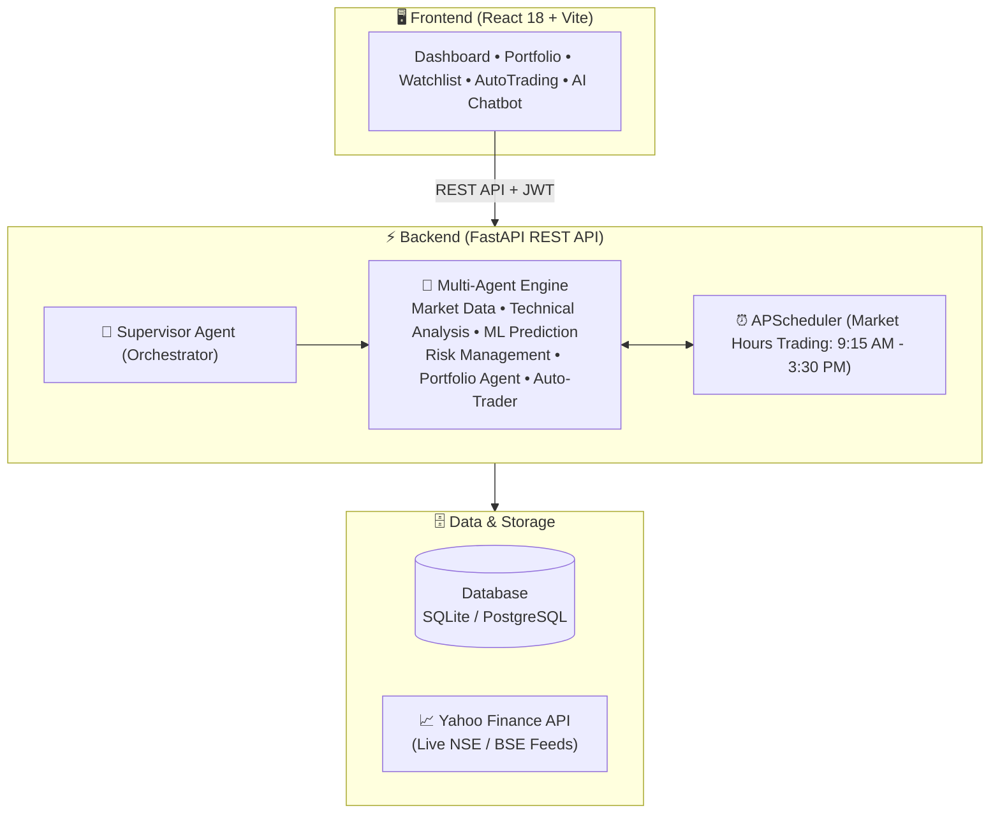

# 🤖 StockAI - Intelligent Stock Prediction & Multi-Agent Trading Assistant

<div align="center">


**An intelligent stock analysis, machine learning prediction, and paper trading system powered by multi-agent AI architecture.**

[Features](#-features) • [Architecture](#-architecture) • [Project Structure](#-project-structure) • [Setup](#-setup) • [API Endpoints](#-api-endpoints)

</div>

---

## 📖 Overview

**StockAI** is a full-stack financial technology web application designed to analyze Indian stocks (NSE), generate short-term price predictions using Machine Learning, and simulate paper trading in a risk-free environment with **₹10,00,000 in virtual cash**.

> ⚠️ **Disclaimer:** This is an educational and research project. All trading is **simulated** (paper trading) — no real money or broker accounts are involved. Predictions are statistical estimates, not financial advice.

---

## ✨ Features

- **📊 Live Indian Market Data**: 120+ NSE stocks and major indices (NIFTY 50, SENSEX, BANK NIFTY) with interactive charts.
- **🤖 Ensemble ML Predictions**: Combines Linear Regression and Random Forest models with technical indicators (RSI, MACD, Bollinger Bands, Moving Averages) to generate **BUY / HOLD / SELL** signals.
- **👥 Multi-Agent Architecture**: Autonomous agent pipeline that handles data ingestion, technical analysis, risk evaluation, and order routing.
- **💼 Paper Trading Engine**: Realistic simulated execution with fee tracking, portfolio allocation charts, and historical P&L analytics.
- **🤖 Autonomous Auto-Trading Agent**: Configurable bot executing rule-based paper trades during market hours (9:15 AM – 3:30 PM IST) with strict stop-loss and daily risk limits.
- **💬 Multilingual AI Assistant**: Context-aware chatbot supporting **English, Hindi (हिंदी), and Marathi (मराठी)**.
- **🎨 Modern Responsive UI**: Glassmorphic dark/light mode interface built with React, Framer Motion, and Tailwind/CSS variables.

---

## 🏗️ Architecture

### High-Level System Flow



### Multi-Agent Pipeline

```text
Market Data  ──▶  Technical Analysis  ──▶  ML Prediction  ──▶  Risk Evaluation  ──▶  Decision Engine  ──▶  Paper Execution
 (Live OHLCV)       (RSI, MACD, SMA)       (Random Forest)     (Limits & Exposure)    (Weighted Signal)    (Virtual Balance)
```

---

## 📁 Project Structure

```text
stock-ai-trading-system/
├── backend/
│   ├── app/
│   │   ├── agents/          # Multi-agent trading orchestration & scheduler
│   │   ├── api/ & routers/  # FastAPI REST endpoints (auth, stocks, portfolio, chat)
│   │   ├── models/          # SQLAlchemy database schemas (user, holdings, orders)
│   │   ├── ml/ & indicators/# ML models (Random Forest, Linear Regression) & technical logic
│   │   ├── database.py      # Database engine & session management (SQLite / SQL Server)
│   │   └── main.py          # FastAPI application entrypoint
│   ├── scripts/             # Data seeding (120+ NSE stocks, market indices)
│   └── requirements.txt     # Python backend dependencies
│
├── frontend/
│   ├── src/
│   │   ├── components/      # UI components (Header, MarketMovers, StockCard, Chatbot)
│   │   ├── pages/           # Pages (Dashboard, StockDetail, Portfolio, AutoTrading)
│   │   ├── context/         # Auth & Theme Context providers
│   │   └── services/        # Axios API client
│   ├── package.json         # Frontend dependencies (React 18, Vite, Chart.js)
│   └── vite.config.js       # Vite configuration
│
├── run_all.bat              # One-click Windows launcher (starts backend + frontend)
├── run_backend.bat          # Backend launcher
├── run_frontend.bat         # Frontend launcher
└── README.md                # Documentation
```

---

## 🛠️ Technology Stack

| Domain | Technologies |
| :--- | :--- |
| **Backend Framework** | Python 3.11+, FastAPI, Uvicorn, Pydantic |
| **Database & ORM** | SQLAlchemy, SQLite (Default zero-config), PostgreSQL / SQL Server compatible |
| **Machine Learning** | scikit-learn, pandas, numpy, yfinance |
| **Frontend Framework** | React 18, Vite, React Router, Framer Motion |
| **Data Visualization** | Chart.js, react-chartjs-2, Recharts |
| **Authentication** | JWT (JSON Web Tokens), Passlib, Bcrypt |

---

## 🚀 Setup & Installation

### Prerequisites
- **Python 3.11+**
- **Node.js 18+**

### 1️⃣ Quick Start (Windows)
Simply run the root launch script:
```powershell
.\run_all.bat
```
This automatically starts both the FastAPI Backend and the Vite React Frontend in separate windows.

---

### 2️⃣ Manual Setup

#### Backend Setup
```powershell
cd backend

# Create and activate virtual environment
python -m venv .venv
.venv\Scripts\activate

# Install dependencies
pip install -r requirements.txt

# Start backend server (auto-seeds stocks on first run)
python -m uvicorn app.main:app --port 8000 --host 0.0.0.0
```
- **Backend API**: `http://localhost:8000`
- **Swagger Documentation**: `http://localhost:8000/docs`

#### Frontend Setup
```powershell
# In a new terminal
cd frontend

# Install dependencies & start dev server
npm install
npm run dev
```
- **Web Application**: `http://localhost:5173`

---

## 🔌 API Endpoints

| Category | Method | Endpoint | Description |
| :--- | :--- | :--- | :--- |
| **Auth** | `POST` | `/api/auth/register` | Register new user account |
| **Auth** | `POST` | `/api/auth/login` | Login and receive JWT access token |
| **Auth** | `GET` | `/api/auth/me` | Fetch current user details |
| **Stocks** | `GET` | `/api/stocks/` | List all tracked stocks with sectors |
| **Stocks** | `GET` | `/api/stocks/{symbol}` | Get real-time stock details |
| **Stocks** | `GET` | `/api/stocks/{symbol}/history` | Historical OHLCV prices |
| **Stocks** | `GET` | `/api/stocks/analyze/{symbol}` | Full AI analysis, indicators & prediction |
| **Stocks** | `GET` | `/api/stocks/market/indices` | Live benchmark indices |
| **Trading** | `POST` | `/api/trading/buy` | Execute paper BUY order |
| **Trading** | `POST` | `/api/trading/sell` | Execute paper SELL order |
| **Portfolio** | `GET` | `/api/portfolio/` | Portfolio summary & current balance |
| **Portfolio** | `GET` | `/api/portfolio/transactions` | Full transaction history |
| **Auto-Trading** | `GET` | `/api/auto-trading/status` | Current state of automated agent |
| **Auto-Trading** | `POST` | `/api/auto-trading/start` | Start auto-trading bot |
| **Auto-Trading** | `POST` | `/api/auto-trading/emergency-stop` | Emergency kill switch |
| **Chatbot** | `POST` | `/api/chat/` | Send message to multilingual AI assistant |

---

## 👨‍💻 Author

**Om Shinde**
- **GitHub**: [@Omshinde1915](https://github.com/Omshinde1915)
- **Repository**: [stock-ai-trading-system](https://github.com/Omshinde1915/stock-ai-trading-system)

---

## 📄 License
This project is developed for educational and academic research purposes.
